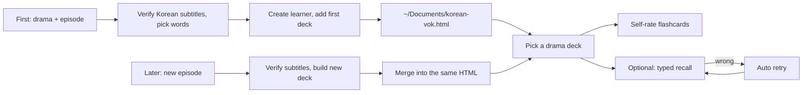

**[🇨🇳 中文](README.md)** · **🇺🇸 English** · [🇰🇷 한국어](README.ko.md)

<div align="center">

# KoreanVok

### Watch Korean dramas, learn real Korean.

Author: 疯狂的豇豆 · [www.crazyowen.cn](https://www.crazyowen.cn)

Give it a Korean drama or film and episode, and it adds that episode's vocabulary to your reusable HTML learner.

[Download demo](https://github.com/owenwuhaha/korean-vok/raw/refs/heads/main/examples/demo.html) · [Install to Codex](#install-to-codex) · [Usage](#usage)


</div>

**KoreanVok** picks practical expressions from a real Korean episode and adds them to one shared HTML learner. The first use creates the learner and adds the first deck; later episodes are merged into the same file — open the page to switch decks. Flashcard self-rating is the default, with optional typed recall and automatic retry.

> The demo page uses 8 original Korean sentences to showcase the learner; they do not come from any drama.

## Korean-specific features

- **Noun part-of-speech tags**: each noun shows its POS (명사/동사/형용사) and common collocations (e.g. `자신감을 가지다`).
- **Verb/adjective stems**: stem + common inflections (e.g. `먹-다` → `먹었다 / 먹고 싶다`).
- **Grammar notes**: particle patterns (`~을/를 잊다`), sentence endings, idioms (`얼떨결에 하다`) go into the card's `grammar` field.
- **Korean TTS**: the page reads sentences with device Korean voice (`ko-KR`).

## Study flow



Each card has the Korean word (with POS), romaji, contextual meaning, original sentence and translation. Self-rating is default; typed recall hides the target expression, checks your input and schedules retries. Acceptable variants are listed explicitly per deck. Each deck keeps its own progress.

Korean level determines the word range: default TOPIK 3–4; if you name an exam and level, it prioritizes that range (e.g. TOPIK I/II, OPIK, SIKAT, CEFR). After generating, the agent asks whether the words feel too hard / right / too easy, and can adjust the range.

## Install

Clone the repo into your platform's Skills directory. Paths and activation below.

### Install to Codex

On macOS / Linux:

```bash
git clone --depth 1 https://github.com/owenwuhaha/korean-vok.git ~/.codex/skills/korean-vok
```

### Install to WorkBuddy

User-level (applies to all projects):

```bash
git clone --depth 1 https://github.com/owenwuhaha/korean-vok.git ~/.workbuddy/skills/korean-vok
```

Project-level (current workspace only, into the project's `.workbuddy/skills/`):

```bash
git clone --depth 1 https://github.com/owenwuhaha/korean-vok.git <your-project>/.workbuddy/skills/korean-vok
```

After cloning, restart WorkBuddy or call `$korean-vok` in chat.

### Install to Doubao

- **Doubao web / client (workspace)**: open "Custom skill / Skill management" → New skill → paste the full `SKILL.md` → name it "KoreanVok / 韩剧词" with triggers (e.g. "韩剧词", "韩语词汇") → save and enable.
- **Doubao TUI (CLI)**: place in the global skills dir and restart the client:

```bash
git clone --depth 1 https://github.com/owenwuhaha/korean-vok.git ~/.doubao/skills/korean-vok
# or ~/.agents/skills/korean-vok
```

### Install to Hermes Agent

On [hermes.crazyowen.cn](https://hermes.crazyowen.cn), register or create an Agent, then paste the `SKILL.md` content into its "persona / instructions" area, naming it "KoreanVok / 韩剧词" with the description from `description`. Once saved, that Agent can extract Korean drama vocabulary.

### Install to OpenClaw

Place in the shared skills directory (applies to all agents on the machine), then restart the gateway:

```bash
git clone --depth 1 https://github.com/owenwuhaha/korean-vok.git ~/.openclaw/skills/korean-vok
openclaw gateway restart   # or a new session /new
openclaw skills list       # verify it loaded
```

Invoke: type `/korean-vok` in chat, or just describe your need in natural language.

---

If already installed, run `git pull` in the skill directory to update. After installing, use it in a new task like:

```text
Use $korean-vok to generate an HTML vocabulary study page for Squid Game S01E01.
```

You can also give the Agent Korean subtitles or script text directly. For other Agents that support Skills, place the whole repo into its personal Skills directory.

## Usage

By default up to 50 Korean words per episode; if subtitle material is thin, generate only what's available — no padding. Existing subtitles are used directly; once a reliable source is found, the process starts without hunting for more sources.

```text
Use KoreanVok to build the deck for 《오징어 게임》 S01E01 and add it to my learner.
```

On first use, the learner is saved at `~/Documents/korean-vok.html` with the first deck. When you name a new episode, the agent merges the new deck back into the same file and delivers the updated HTML, noting which episode was added — no manual JSON import. If the file is already open in a browser, just reopen it to see the new deck. If the agent can't find or read the existing learner, it asks for the file path or the file instead of creating an empty library that would overwrite it.

Double-click `korean-vok.html` to study. The page needs no Anki, server or network, and no Python. Default is flashcard self-rating; switch to "typed recall" in the page. That choice is stored in the current browser and applies to all decks. The HTML file holds the whole library — copy it to back up decks; progress and mode preferences live in the browser, so use the page's progress-backup feature to export them. Switching browsers, devices or moving the file won't auto-carry local data; full migration needs both the HTML and the progress backup. Device voice availability depends on the browser.

After each generation, note the agent's difficulty check-in. Reply "too hard" or "too easy" and tell it which exam and level you're targeting, and it updates the same deck — no manual JSON import.

## Scope

- Korean drama single-episode / podcast-segment vocabulary (Korean dramas, films, anime, news, podcasts).
- Sources and content must be verifiable to the named episode/show; when no reliable Korean subtitle exists, the agent asks you to provide one instead of inventing lines.
- Only selected study examples are stored, not whole-episode subtitles.
- The web page supports multi-deck switching and wrong-word retry; no cross-day FSRS/Anki-style review scheduling yet.
- "Correct this round" means this input was right, not that you've permanently remembered it.

## Manual generation

Python 3 stdlib is needed to validate decks and merge them into the reusable learner; learners only need a browser.

```bash
python3 scripts/build_html.py examples/demo.json study.html
```

Deck data format in [references/data-format.md](references/data-format.md). The page embeds the whole library via `vocab-library`; the delivered HTML needs no JSON or other companion files. Maintainers can still create HTML from a single-deck JSON.

## Project structure

| Path | Purpose |
|---|---|
| `SKILL.md` | Agent trigger + generation flow (Korean-only) |
| `assets/study.html` | Reusable learner template (Korean POS/collocation display, ko-KR TTS) |
| `scripts/build_html.py` | Validates cards and generates the study page |
| `references/` | Korean subtitle sources + card format notes |
| `examples/demo.html` | Openable original Korean demo |

## Maintainer verification

When the template or generator changes, run:

```bash
python3 -m unittest discover -s tests -p 'test_*.py'
npm install && npm test
```

Browser interaction tests use local Chrome and Playwright. Deck generation/merge and offline Chrome interaction tests are run, covering default self-rating, input-mode switching, cross-deck preferences, per-episode progress isolation, HTML merge-update, legacy single-deck migration and language/exam metadata. Device voice is not verified for sound.

## Attribution & license

This project is adapted from [pyang5166/gbro-series-vocab](https://github.com/pyang5166/gbro-series-vocab), turning Anki/Markdown delivery into a standalone HTML learner and locking the study language to Korean (adding POS/collocation/grammar notes and ko-KR TTS). Author: 疯狂的豇豆 ([www.crazyowen.cn](https://www.crazyowen.cn)); upstream MIT license and original author pyang5166's copyright are preserved. TypeWords' practice design is reference only; this repo does not copy its GPL-3.0 source.
