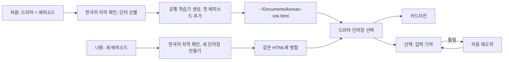

**[🇨🇳 中文](README.md)** · [🇺🇸 English](README.en.md) · **🇰🇷 한국어**

<div align="center">

# 한국드라마 단어 · KoreanVok

### 한국 드라마·영화·팟캐스트 자막을, 오프라인으로 풀 수 있는 HTML 단어 카드 학습기로 바꿔 드립니다.

저자: 疯狂的豇豆 · [www.crazyowen.cn](https://www.crazyowen.cn)

> 드라마·영화에서 배운 실제 표현은 가장 실용적이면서도 가장 외우기 어렵습니다. 한국 드라마/영화/팟캐스트 자막을 **KoreanVok**에 넘기면, 해당 회차의 자주 쓰이는 실용 어휘를 HTML 단어 카드 학습기로 만들어 줍니다. **더블클릭이면 바로 시작**, 오프라인 사용 가능, Anki 설치 불필요, 인터넷 연결 불필요.

[라이브 데모 열기 (자체 한국어 예문 8개)](https://github.com/owenwuhaha/korean-vok/raw/refs/heads/main/examples/demo.html) · [설치](#설치) · [사용법](#사용법)


</div>

---

**한 줄 요약**: “KoreanVok + 드라마명 + 회차”를 입력하면 `~/Documents/korean-vok.html`이 생성됩니다 — 해당 회차의 자주 쓰이는 실용 어휘를 한자어, 품사, 문법 비고, 한국어 낭독과 함께 정리해 줍니다. 기본은 카드 넘기기(셀프 평가)이며, 자동 채점·오답 재도약이 가능한 “입력 회상” 모드로도 전환할 수 있습니다. 새로운 회차마다 같은 파일에 자동 병합되어, **HTML 파일 하나가 곧 나의 한국어 단어장**이 됩니다.

**이런 사람에게**: 드라마/영화/팟캐스트를 보며 어휘를 늘리고 싶은 분; TOPIK / OPIK / SIKAT 시험을 대비하며 실제 문장으로 연습하고 싶은 수험생; **소프트웨어 설치 없이 완전 오프라인**으로 단어를 돌리고 싶은 분.

**이 도구의 강점**:

| 받을 수 있는 것 | 설명 |
|---|---|
| **실제 어감** | 단어장은 전부 실제 자막에서 — 교과서 예문이 아님 |
| **진입 장벽 제로** | HTML을 더블클릭하면 즉시 사용, Anki·인터넷·서버 불필요 |
| **한국어 디테일** | 명사/동사 품사(명사/동사/형용사) 표시, 동사 어근과 활용(먹-다 → 먹었다 / 먹고 싶다), 조사 결합·고정 표현(얼떨결에 하다)을 문법 비고로 |
| **수준에 맞는 선별** | 기본 TOPIK 3–4급, 목표 등급을 알려 주면 해당 범위로 선별하며 난이도 피드백으로 상하 조절 |
| **언제든 사용 가능** | 오프라인 낭독(기기의 ko-KR 음성), 오답은 자동으로 재도약 대기열에 복귀 |

> 데모 페이지는 어떤 드라마에서 가져온 것이 아니라, 기능을 보여주기 위한 8개의 자체 한국어 문장입니다.

## 한국어 전용 기능

- **명사 품사 표시**: 각 명사는 품사(명사/동사/형용사 등)와 자주 쓰이는 결합(예: `자신감을 가지다`)을 보여줍니다.
- **동사/형용사 어간 표시**: 어간과 자주 쓰이는 활용(예: `먹-다` → `먹었다 / 먹고 싶다`).
- **문법 비고**: 격조사 결합(`~을/를 잊다`), 문말 어미, 관용 표현(`얼떨결에 하다`) 등을 카드의 `grammar` 필드에 기록합니다.
- **한국어 낭독**: 페이지가 기기의 한국어 음성(`ko-KR`)으로 문장을 읽습니다.

## 학습 흐름



각 단어 카드에는 한국어 단어(품사 포함), 로마자 표기, 문맥 의미, 원문과 번역이 있습니다. 기본은 카드자진이며, 입력 기억은 원문 속 대상 표현을 숨기고 입력을 검사해 틀린 단어를 재도약 순서로 배치합니다. 허용되는 철자·표현 변형은 단어장이 명시합니다. 드라마별 단어장은 연습 진행을 따로 저장합니다.

한국어 등급은 단어 범위를 결정합니다: 기본 TOPIK 3–4. 사용자가 시험과 등급을 말하면 해당 시험 범위(예: TOPIK I/II, OPIK, SIKAT, CEFR)를 우선 선별합니다. 생성 후 Agent가 단어가 너무 어렵거나, 적당하거나, 너무 쉽냐고 물어보고 피드백에 따라 범위를 조정할 수 있습니다.

## 설치

이 저장소를 해당 플랫폼의 Skills 디렉토리에 복제하면 됩니다. 플랫폼별 경로와 활성화 방법은 아래를 참고하세요.

### Codex에 설치

macOS / Linux:

```bash
git clone --depth 1 https://github.com/owenwuhaha/korean-vok.git ~/.codex/skills/korean-vok
```

### WorkBuddy에 설치

사용자 수준(모든 프로젝트에 적용):

```bash
git clone --depth 1 https://github.com/owenwuhaha/korean-vok.git ~/.workbuddy/skills/korean-vok
```

프로젝트 수준(현재 워크스페이스만, 프로젝트의 `.workbuddy/skills/`에):

```bash
git clone --depth 1 https://github.com/owenwuhaha/korean-vok.git <프로젝트>/.workbuddy/skills/korean-vok
```

복제 후 WorkBuddy를 다시 시작하거나, 대화에서 `$korean-vok`을 바로 호출하세요.

### Doubao(豆包)에 설치

- **Doubao 웹/클라이언트(워크스페이스)**: 「사용자 정의 스킬 / 스킬 관리」→ 새 스킬 → 이 저장소의 `SKILL.md` 전체를 스킬 내용에 붙여넣기 → 이름「KoreanVok / 韩剧词」과 트리거(예: 「韩剧词」「韩语词汇」)를 입력 → 저장하고 활성화.
- **Doubao TUI(커맨드라인 버전)**: 전역 스킬 디렉토리에 넣고 클라이언트를 다시 시작:

```bash
git clone --depth 1 https://github.com/owenwuhaha/korean-vok.git ~/.doubao/skills/korean-vok
# 또는 ~/.agents/skills/korean-vok
```

### Hermes Agent에 설치

[hermes.crazyowen.cn](https://hermes.crazyowen.cn)에서 Agent를 등록하거나 만들고(커뮤니티 검증 절차 완료 후), 그 「퍼소나 / 지시」 영역에 이 저장소의 `SKILL.md` 내용을 붙여넣고 이름을 「KoreanVok / 韩剧词」로, 설명을 SKILL.md의 `description`에서 가져다 쓰세요. 저장 후 그 Agent는 한국 드라마 단어 추출 기능을 갖게 됩니다.

### OpenClaw에 설치

공유 스킬 디렉토리에 넣고(해당 기기의 모든 Agent에 적용) 게이트웨이를 다시 시작하세요:

```bash
git clone --depth 1 https://github.com/owenwuhaha/korean-vok.git ~/.openclaw/skills/korean-vok
openclaw gateway restart   # 또는 새 세션 /new
openclaw skills list       # 로드 확인
```

호출: 대화에서 `/korean-vok`을 입력하거나, 자연 언어로 필요를 설명하세요.

---

이미 설치했다면 스킬 디렉토리에 들어가 `git pull`로 업데이트하세요. 설치 후 새 작업에서 이렇게 사용하세요:

```text
$korean-vok을 사용해 Squid Game S01E01의 HTML 단어 학습 페이지를 만들어 주세요.
```

Agent에게 한국어 자막이나 대본 텍스트를 직접 주는 것도 가능합니다. 다른 Skills를 지원하는 Agent의 경우, 저장소 전체를 해당 Agent의 개인 Skills 디렉토리에 넣으면 됩니다.

## 사용법

기본적으로 에피소드당 최대 50개의 한국어 단어를 정리하며, 자막 자료가 부족하면 실제 내용만큼 생성하고 수를 채우지 않습니다. 기존 자막이 있으면 그대로 사용하며, 신뢰할 수 있는 출처를 하나 확보하면 바로 정리를 시작합니다.

```text
KoreanVok으로 《오징어 게임》 S01E01 단어장을 만들어 내 학습기에 추가해 주세요.
```

처음 사용할 때 학습기는 `~/Documents/korean-vok.html`에 첫 에피소드와 함께 저장됩니다. 이후 새 에피소드를 말하면 Agent가 새 단어장을 같은 파일에 병합하고 업데이트된 HTML을 전달하며 어떤 에피소드가 추가됐는지 설명합니다. JSON을 수동으로 가져올 필요가 없습니다. 이미 브라우저에서 열려 있으면 업데이트된 파일을 다시 열면 새 단어장이 보입니다. 기존 학습기를 찾지 못하거나 읽지 못하면 Agent는 빈 단어장을 만들어 덮어쓰지 않고 파일 경로 또는 파일을 요청합니다.

`korean-vok.html`을 더블클릭하면 학습할 수 있습니다. 웹 페이지는 Anki, 서버, 네트워크가 필요 없고 Python도 설치하지 않아도 됩니다. 기본은 카드자진이며, 페이지에서 「입력 기억」으로 바꿀 수 있습니다. 이 선택은 현재 브라우저에 저장되어 모든 단어장에 적용됩니다. HTML 파일은 전체 단어장을 담고 있어 복사하면 단어장을 백업할 수 있습니다. 연습 진행과 모드 설정은 브라우저에 저장되어, 페이지의 진행 백업 기능으로 따로 내보내야 합니다. 브라우저/기기를 바꾸거나 파일을 옮기면 로컬 데이터가 자동으로 따라오지 않을 수 있으며, 완전한 이사는 HTML과 진행 백업이 모두 필요합니다. 기기 음성 사용 가능 여부는 브라우저에 따라 다릅니다.

각 생성 후 Agent의 난이도 피드백을 확인하세요. 「너무 어렵다」또는 「너무 쉽다」에 대해 목표 시험과 등급을 알려 주면 Agent가 같은 드라마 단어장을 업데이트합니다. JSON을 수동으로 가져올 필요가 없습니다.

## 적용 범위

- 한국 드라마 에피소드/팟캐스트 구간의 단어 학습(한국 드라마, 영화, 애니메이션, 뉴스, 팟캐스트).
- 출처와 내용은 지정한 에피소드/프로그램으로 확인 가능해야 합니다. 신뢰할 수 있는 한국어 자막이 없으면 Agent는 스스로 대사를 지어내지 않고 자막 제공을 요청합니다.
- 선별된 학습 예문만 저장하고, 에피소드 전체 자막은 웹 페이지에 넣지 않습니다.
- 웹 페이지는 여러 드라마 단어장 전환과 틀린 단어 재도약을 지원합니다. 아직 당일 간의 FSRS/Anki식 복습 스케줄은 제공하지 않습니다.
- 「이번 회답 맞음」은 이번 입력이 맞았다는 뜻이지, 오래 기억했다는 뜻이 아닙니다.

## 수동 생성

단어장 검증과 공통 학습기 병합에는 Python 3 표준 라이브러리만 필요하며, 학습자는 브라우저만 있으면 됩니다.

```bash
python3 scripts/build_html.py examples/demo.json study.html
```

단어장 데이터 형식은 [references/data-format.md](references/data-format.md)를 참고하세요. 페이지는 `vocab-library`로 전체 단어장을 내장하며, 전달하는 HTML에는 JSON 또는 다른 파일이 필요 없습니다. 유지보수자가 수동으로 데모 페이지를 만들 때도 단일 JSON에서 HTML을 만들 수 있습니다.

## 프로젝트 구조

| 경로 | 용도 |
|---|---|
| `SKILL.md` | Agent 트리거 조건과 생성 흐름(한국어 전용) |
| `assets/study.html` | 공통 학습기 템플릿(한국어 품사/결합 표시, ko-KR 낭독) |
| `scripts/build_html.py` | 카드 검증 및 학습 페이지 생성 |
| `references/` | 한국어 자막 출처와 카드 형식 설명 |
| `examples/demo.html` | 바로 여는 자체 한국어 예시 |

## 유지보수자 검증

템플릿 또는 생성기를 바꿨을 때 아래를 실행할 수 있습니다:

```bash
python3 -m unittest discover -s tests -p 'test_*.py'
npm install && npm test
```

브라우저 인터랙션 테스트는 로컬 Chrome과 Playwright를 사용합니다. 단어장 생성/병합 테스트와 Chrome 오프라인 인터랙션 테스트를 수행하여 기본자진, 입력 모드 전환, 단어장 간 설정 공유, 에피소드별 진행 격리, HTML 병합 업데이트, 구버전 단일 단어장 마이그레이션, 언어/시험 메타데이터를 커버합니다. 기기 음성은 청감 검증하지 않습니다.

## 출처와 라이선스

이 프로젝트는 [pyang5166/gbro-series-vocab](https://github.com/pyang5166/gbro-series-vocab)에서改編하여, Anki/Markdown 인도를 독립 HTML 학습 페이지로 바꾸고 학습 언어를 한국어로 고정했습니다(품사/결합/문법비고와 ko-KR 낭독 추가). 저자: 疯狂的豇豆([www.crazyowen.cn](https://www.crazyowen.cn)), 상류 MIT 라이선스와 원저자 pyang5166(狗哥笔记)의 저작권 표시는 유지합니다. TypeWords의 연습 설계는 참고만이며, 이 저장소는 그 GPL-3.0 소스코드를 복제하지 않았습니다.
